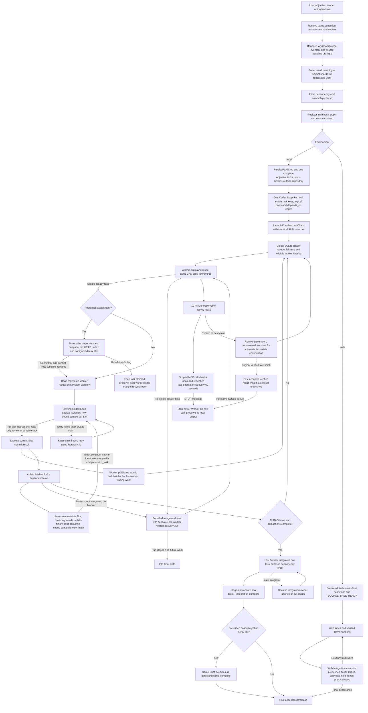

# Thread Development Orchestrator Architecture

## Authority and data flow

- The coordinator performs a bounded inventory, then **defaults to small useful shards** for repeatable work (documents, generation, revisions, batch QA, independent tests). A shard has a fixed input subset, exclusive output/receipt, meaningful work and independent retry. It avoids giant per-author/project jobs, but also avoids trivial or speculative empty tasks whose handoffs dominate. Source-shard completion should release its own downstream generation/review rather than waiting for unrelated authors or files.
- The coordinator owns the **initial planned graph**: stable task identities, logical Pool names, true prerequisite edges, resource/exclusive-write boundaries, source contracts, exact acceptance/test gates and legitimate rework branches. Calling the Skill for orchestration creates the Run after initial source checks and registration, without a separate approval gate. An already open same-goal Run is inspected first, rather than silently duplicated. A Pool is a fairness grouping, never a hard concurrency reservation or a Wave-wide gate.
- Local initial task definitions and PLAN hashes live on the authorized host outside target Git worktrees; the live SQLite graph can be atomically amended for unclaimed tasks. The complete task file is passed once to Codex Loop `collab create`; SQLite owns current ready/claimed/completed task state and dispatch fairness, Git owns code history. A completed task's verified own commit range can be safely materialized into another worker's isolated checkout before it begins downstream work.
- After its first successful Local claim, the Chat queries the existing host-local SQLite `workers` registrations read-only. Its order within that Run determines `<RepoDirectory>-worker<N>`; the assistant prints this name immediately in user-visible chat text. Worker naming needs no extra registry or individualized launcher; Codex Loop registers stable worker ownership in its existing SQLite store. A Chat keeps the name on later claims and resumption.
- Every active Chat retains its own lifecycle `task_id` and worktree while automatically claiming further Ready tasks. An immediately Ready next task is returned by `collab finish`; otherwise the same Chat uses bounded `collab claim --wait` foreground calls (default check interval 30 seconds; separate idle heartbeat; no claimed Slot or lease renewal). Scoped MCP hooks can observe tool activity and urgent inbox/control messages before each tool call, rate-limiting SQLite writes to once per 60 seconds when installed; otherwise workers report explicit heartbeats. Stale leases can be reclaimed after 600 seconds without observable tool activity, with worker-owned Worktree isolation, recovery evidence and owner-generation fencing; resume from the old worker's verified Git/file state without requiring checkpoints; ignored files and uncertain external effects still need review; closed Chats are not awakened; a pool with Ready work receives priority at the **next active claim** and may borrow all idle capacity without limits.
- Final integration starts only after every required task and tracked delegation is resolved, not after an arbitrary Wave. Commit deltas are integrated in DAG order, avoiding duplicated imported prerequisites. A post-integration serial chain belongs to the elected Integrator in the same Chat until its real gates complete.
- Web lacks shared host-local SQLite and retains frozen physical waves, Drive-backed verified handoffs, and an explicit Integration lane. A Web lane must not claim Local DAG scheduling capabilities. Authorization never transfers between Chats; failure recovery preserves previous worktrees and never blindly replays ambiguous writes.
